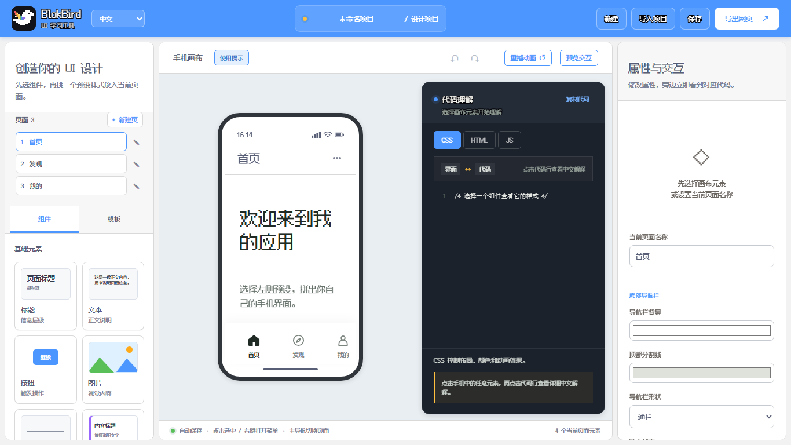

<div align="center">
  
  <h1>BlokBird</h1>
  <p><strong>在浏览器里设计手机界面，同时看懂 HTML、CSS 和 JavaScript。</strong></p>
  <p>面向前端初学者的交互式 UI 工具：在手机画布中自由创作，并从每一次修改中学习代码。</p>
  <p><a href="https://luke0485.github.io/BlokBird/"><strong>在线体验</strong></a> · <a href="https://github.com/luke0485/BlokBird">查看源码</a> · <a href="LICENSE">MIT License</a></p>
</div>



## 为什么是 BlokBird

BlokBird 把**组件、手机画布、代码理解与属性设置**放在同一个工作区。放入按钮、调整尺寸、修改颜色或添加动画时，旁边的代码会同步变化；点击代码行，可以阅读它为什么这样写、如何影响眼前的界面。

## 可以做什么

- 使用标题、文本、按钮、图片、卡片、输入框、开关、分隔线和布局搭建手机页面
- 9 类组件、80+ 预设样式，支持拖动排序、8 方向缩放与位置偏移
- 点击左侧「图片」直接打开素材库：上传图片、纯色背景本地抠图、搜索内置素材
- 通过模板生成互相关联的多页面流程，配置页面跳转、提示、弹窗、链接和输入校验
- 从组件里的「效果」入口选择 11 种入场动画与 7 种视觉效果，可调时长、延迟和触发方式
- 按当前电脑时间显示手机状态栏，并提供信号、WiFi 与电量图标
- 点击 HTML / CSS / JS 代码行，结合当前界面阅读中文解释
- 自定义底部导航栏颜色、形状、高度、图标和选中状态

## 保存与导出

- 「保存」在页面内弹窗中命名项目，将 JSON 备份保存到本机（通过系统保存对话框，默认桌面）。
- 「导出网页」生成以项目名命名的独立 HTML，页面顶部显示项目名，默认保存到桌面。
- 导出页内嵌像素字体和图片，断网也能打开；整个导出过程只在浏览器本地完成，不上传、不发布。

## 开始使用

直接打开 [在线版本](https://luke0485.github.io/BlokBird/)，从左侧选择组件并放入手机画布。选中元素后，在右侧修改内容、尺寸、颜色、动画与交互；代码理解区会同步展示对应实现。

本地无需构建：克隆仓库后直接打开 `index.html`。运行测试需要 Node.js 20 或更高版本：

```bash
npm test
```

项目数据保存在浏览器 `localStorage` 中。

## 字体

界面使用 [Fusion Pixel 12px Proportional SC](https://github.com/TakWolf/fusion-pixel-font)（SIL OFL 1.1）。许可证见 [`fonts/LICENSE-OFL.txt`](fonts/LICENSE-OFL.txt)。

## 技术与开源

项目使用原生 HTML、CSS 和 JavaScript，无构建步骤、无第三方运行时依赖，可部署到任意静态网站服务（当前使用 GitHub Pages）。

**作者：luke0485、GPT 5.6sol**
本项目使用 [MIT License](LICENSE) 开源。
