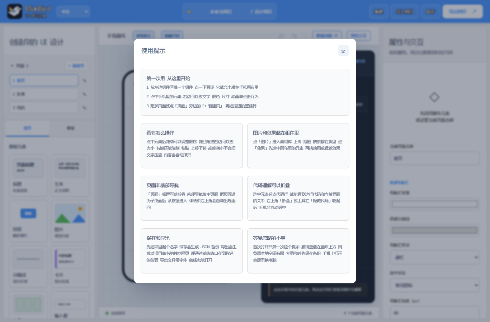
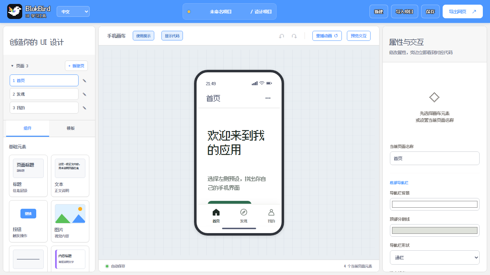
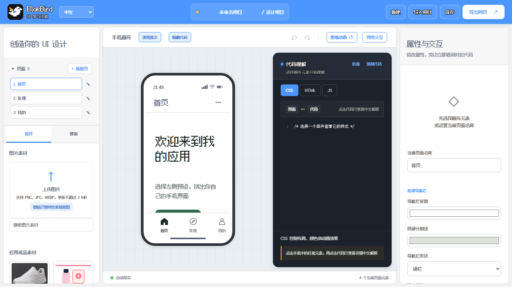

<div align="center">
  
  <h1>BlokBird</h1>
  <p><strong>把界面变成代码 把代码变成理解</strong></p>
  <p>一个在浏览器里设计手机界面的小工具 也是给前端初学者准备的可视化代码笔记</p>
  <p><a href="https://luke0485.github.io/BlokBird/"><strong>在线玩一玩</strong></a> · <a href="https://github.com/luke0485/BlokBird">查看源码</a> · <a href="LICENSE">MIT License</a></p>
</div>


## 先说这是什么

BlokBird 不想让你先背一堆语法 它更像一块可以随便摆弄的手机屏幕
把按钮拖进去 改个颜色 加个动画 旁边的 HTML CSS JS 会跟着变
点一下代码行 还能看到这行代码为什么这样写 以及它正在影响界面里的哪一部分

## 第一次打开

第一次打开会自动弹出一份使用提示
里面写了怎么开始 画布怎么操作 页面和代码面板怎么折叠 还有几个容易忽略的地方
看完关掉就行 之后想再看 点画布上方的「使用提示」

## 五分钟上手

1 从左边组件区挑一个组件 点一下预设 它就会出现在手机画布里
2 点中手机里的元素 右边可以改文字 颜色 尺寸 动画和点击行为
3 想加页面就点「页面」旁边的「+ 新建页」 再给按钮设置跳转

## 几个容易被忽略的细节

- 元素的高度是「最小高度」 拖小不会把文字压扁 内容会自动把盒子撑开
- 拖四角或四边可以改大小 左右上下都会按你拖的方向走
- 右键元素可以复制 粘贴 上移 下移 删除
- 「页面」标题可以折叠 页面多的时候会清爽很多
- 代码理解可以折叠 折叠后手机会自动占满画布并居中
- 图片在组件里的「图片」入口 上传 抠图 搜索都在素材库
- 效果也在组件里 先选中画布元素 再挑动画或视觉效果
- 首次的使用提示只会自动弹一次 不会每次打扰你

## 保存与导出

- 「保存」会弹一个站内小窗 给项目起名 然后把 JSON 备份存到你选的位置
- 「导出网页」会生成一个以项目名命名的独立 HTML 文件 页面顶部会显示项目名 默认存到桌面
- 导出的文件内嵌字体和图片 断网也能打开 整个导出只在浏览器本地完成 不上传 不发布

## 它长什么样

| 使用提示 | 代码折叠 |
| --- | --- |
|  |  |



## 里面有这些东西

- 9 类组件 80+ 预设 拖动排序 8 方向缩放
- 模板会一次性生成互相关联的多页面流程 按钮跳转 提示 弹窗 链接 输入校验都能配
- 11 种入场动画 7 种视觉效果 时长 延迟 触发方式都能调
- 手机状态栏显示当前电脑时间 信号 WiFi 电量
- 页面可以设成主导航页或子页面 详情页自带返回
- 素材库支持上传 PNG JPG WEBP 纯色背景在浏览器本地抠图
- 代码理解区支持点击代码行看中文解释 支持折叠
- 保存 JSON 项目文件 导出独立网页

## 它是怎么做的

原生 HTML CSS JavaScript 没有构建步骤 没有第三方运行时依赖
项目数据存在浏览器 localStorage 里 导出时会把字体和图片一起打包
项目主体是单页应用 部署到任意静态网站都可以 当前跑在 GitHub Pages

## 本地运行

克隆仓库后直接打开 index.html 就行 不需要安装依赖
跑测试需要 Node 20 或更高版本

```bash
npm test
```

## 常见问题

**手机上能打开吗**
编辑器目前按桌面尺寸设计 手机上会提示换电脑 导出的网页可以在手机看

**数据存在哪里**
浏览器 localStorage 换浏览器 清缓存 换电脑都不会自动同步
重要的项目建议用「保存」导出 JSON 备份

**导出的文件为什么有点大**
字体和图片都内嵌在 HTML 里 这样断网也能保持完整效果 单文件大约 300KB

**字体为什么叫 BlokBird Pixel**
界面字体基于开源的 Fusion Pixel 12px SC 提取常用字子集 并按 OFL 要求改了名字
许可证在 fonts/LICENSE-OFL.txt 完整字体项目在 [TakWolf/fusion-pixel-font](https://github.com/TakWolf/fusion-pixel-font)

## 路线图

更细的组件复用 动画时间轴 无障碍 模板预览 都在 ROADMAP 里
想看接下来做什么 可以打开 [ROADMAP.md](ROADMAP.md)

## 作者与许可

作者 luke0485 和 GPT 5.6sol
项目使用 MIT License 开源 欢迎拿去改 也欢迎提问题和建议
